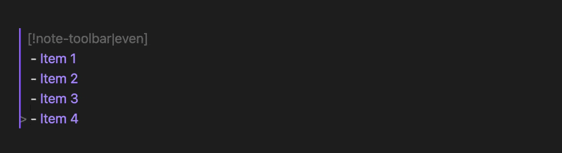
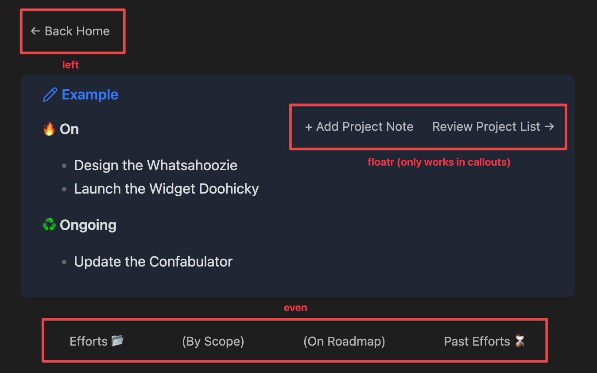

<!-- Generated from docs/wiki/Note-Toolbar-Callouts.md by build/copy-skill-references.mjs. Do not edit by hand. To update, run: npm run build:skills -->

**Note Toolbar Callouts** allow you to add toolbars within the content of your notes. These allow for flexibility, and using other plugins (e.g., Templater, Dataview) to generate the contents of the toolbar.



Get started writing your own by creating a callout containing a list of links, like the below, or learn about [[creating callouts from toolbars]].
```markdown
> [!note-toolbar]
> - [Some Website](https://google.com)
> - [Some Command](obsidian://workspace:toggle-pin)
> - [[Some Note]]
```

Read on for the syntax.

> [!tip]
> Enable the setting **Other → Lock Note Toolbar Callouts** to prevent edits to callouts when you click/tap on anything other than a toolbar item.
> - Once enabled, you will need to right-click (long-press on mobile) the callout and select **Edit** to make changes.
> - For convenience, the command `Note Toolbar: Lock/Unlock Note Toolbar Callouts` toggles this setting on and off.

## Line breaks and separators

For separators use `<hr/>` and for line breaks use `<br/>`:

```markdown
> [!note-toolbar]
> - [Item before line break](...)
> - <br/>
> - [Item after line break](...)
> - [Item before separator](...)
> - <hr/>
> - [Item after separator](...)
```

## Styling

To control its appearance, optionally add metadata by adding a `|` and then list styles (as defined in the table below), separated with spaces or a character (the example below uses `-`).

For example, here's the above callout with three styles applied:

```markdown
> [!note-toolbar|border-right-sticky]
> - [Some Website](https://google.com)
> - [Some Command](obsidian://workspace:toggle-pin)
> - [[Some Note]]
```

**Style metadata**

Below is a complete list of style callout metadata you can use in Note Toolbar callouts. For visual examples of each, [see how styles are applied](https://github.com/chrisgurney/obsidian-note-toolbar/wiki/Styling-toolbars#how-styles-are-applied).

To add your own styles, see [[Custom styling|Custom-styling#apply-styling-to-callouts]].

| Default Style | Mobile Style | Description |
| --- | --- | --- |
| `border` | `mbrder` | Adds a top and bottom border |
| `noborder` | `mnbrder` | Turns off border (default) |
| `button` | `mbtn` | Applies a button-like appearance |
| `card` | `card` | Card style (see below) |
| `center` | `mctr` | Aligns items center |
| `between` | `mbtwn` |  Spreads items out edge to edge |
| `even` | `mevn` | Distributes items evenly, keeping them centered |
| `floatl` | `mfltl` | Floats the toolbar left of nearby content within a callout |
| `floatr` | `mfltr` | Floats the toolbar right of nearby content within a callout |
| `nofloat` | `mnflt` | Turns off float (default) |
| `left` | `mlft` | Aligns items left (default) |
| `right` | `mrght` | Aligns items right |
| `sticky` | `mstcky` | Sticks toolbar to top on scroll.<br/>⚠️ Note: Sticky Note Toolbar Callouts may disappear when scrolling through a long note; [see this note](https://github.com/chrisgurney/obsidian-note-toolbar/wiki/Troubleshooting#sticky-note-toolbar-callouts-disappear-when-scrolling-through-a-long-note) for details. |
| `nosticky` | `mnstcky` | Turns off stickiness (default) |
| n/a | `mnwrp` | _Mobile only:_ When set, all items will be on one line making the toolbar horizontally scrollable.<br/>⚠️ For this to work best, ensure your items are left-aligned (i.e., not centered or evenly spaced). |
 
> [!tip]
> Hovering over a style in settings will show you the metadata to use in your callout, from the above list:
> 
> 

## Adding icons

The [Iconize ↗](https://github.com/FlorianWoelki/obsidian-iconize) plugin allows you to add icons to your notes, and works well in callouts. For example:

```markdown
>[!note-toolbar]
> - [:LiPin: Pin note](<obsidian://note-toolbar?commandid=workspace:toggle-pin>)
```

...appears as:


## Callout "Card" style


Use the `card` style to create a larger format toolbar. This can be helpful for "navigation" notes, such as a home dashboard.

- The [Iconize plugin](https://github.com/FlorianWoelki/obsidian-iconize) is required to add icons.
- Control the width and number of cards with these CSS variables in a snippet:
  - desktop and mobile: `--ntb-callout-card-width` and `--ntb-callout-card-flex`
  - mobile override: `--ntb-callout-card-width-mobile` and `--ntb-callout-card-flex-mobile`
- Add the `nowrap` or `mnwrp` (for mobile only) style to have the cards horizontally scrollable, as shown in the screenshot.
- Change the color of icons via the callout metadata. Supported: `red-icon`, `orange-icon`, `yellow-icon`, `green-icon`, `cyan-icon`, `blue-icon`, `purple-icon`, `pink-icon`

For example, this shows three cards across a note (in the Default theme, with default settings), with blue icons:

```markdown
> [!note-toolbar|card-blue-icon]
> - [[Home.md|:LiHome: Home]]
> - [:LiGlobe: Website](<https://google.com/>)
> - [:LiCalendar1: Today]()<data data-ntb-command="daily-notes"/>
```

Add more cards and make them scroll (as shown in the screenshot):

```markdown
> [!note-toolbar|card-green-icon-nowrap]
> - [[Welcome To The Vault.md|:LiHome: Home]]
> - [:LiGlobe: Google](<https://chrisgurney.ca/>)
> - [:LiCalendar1: Today]()<data data-ntb-command="daily-notes"/>
> - [[Meetings.md|:LiPhone: Meetings]]
> - [[Creative.md|:LiPalette: Creative work]]
```

Here's an example of a [Dataview JS script](https://github.com/chrisgurney/obsidian-note-toolbar/discussions/499) that shows your bookmarks as a scrollable list of cards.

## Open menus, execute commands, focus on folders

Two methods are available to add menus, execute commands, and focus on folders from callouts:

### Note Toolbar URIs

[[Note Toolbar URIs]] can be used within links, like this:

```markdown
> [!note-toolbar]
> - [Command URI](obsidian://note-toolbar?command=workspace:toggle-pin)
> - [Folder URI](obsidian://note-toolbar?folder=Demos)
> - <hr>
> - [Menu URI](obsidian://note-toolbar?menu=Tools)
> - [Menu URI with ID](obsidian://note-toolbar?menu=7fb30215-d92c-43ce-8158-b79096672bd1)
```

> [!tip]
> Get a Note Toolbar URI for a command using the `Note Toolbar: Copy URI for command` command.

Note:
- URIs don't appear to work in notes that were opened in a new window, as the focus is returned to the main window on click. If that's not suitable for you, use the next method.

### Data elements

Note Toolbar data elements are appended to the end of an empty link, like this:

```markdown
> [!note-toolbar]
> - [Command]()<data data-ntb-command="workspace:toggle-pin"/>
> - [Folder]()<data data-ntb-folder="Demos"/>
> - <hr>
> - [Menu]()<data data-ntb-menu="Tools"/>
> - [Menu with ID]()<data data-ntb-menu="7fb30215-d92c-43ce-8158-b79096672bd1"/>
```

> [!tip]
> Get a callout item for a command using the `Note Toolbar: Copy callout item for command` command.

*Demo:*


Notes:
- The `folder`, `menu`, and `command` types require empty links `()`, or Obsidian will open the link content instead.
- Ensure the `<data>` element is closed (i.e., ends with a `/>`).
- These links work in new windows opened from a note as well, unlike `obsidian://` URIs which seem to return focus to the main window.

### Notes for both methods

- A message is displayed if the provided command, folder, or URI is invalid.
- For menus, you can pass in the toolbar name or the UUID, as shown above.
- For commands:
  - You can use either `command=` or `commandid=` as both work the same.
  - URIs must be encoded (e.g., `:` becomes `%3A`) or you can surround the Obsidian URL with `<` and `>`.
  - Use one of the commands mentioned to easily get the URI or data element:
    - `Note Toolbar: Copy URI for command`
    - `Note Toolbar: Copy callout item for command`

## Examples

Use Note Toolbar Callouts anywhere in your notes, including within other callouts. Below is an example with the styles that are applied:



[[Here's another example|Bookmarks]] that shows your bookmarks, thanks to Dataview.

---

### Learn more: [[Creating callouts from toolbars]] • [[Creating toolbars from callouts]]

### Read next: [[Sharing toolbars]]